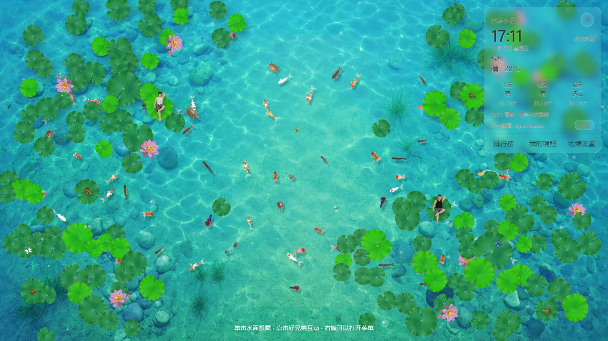
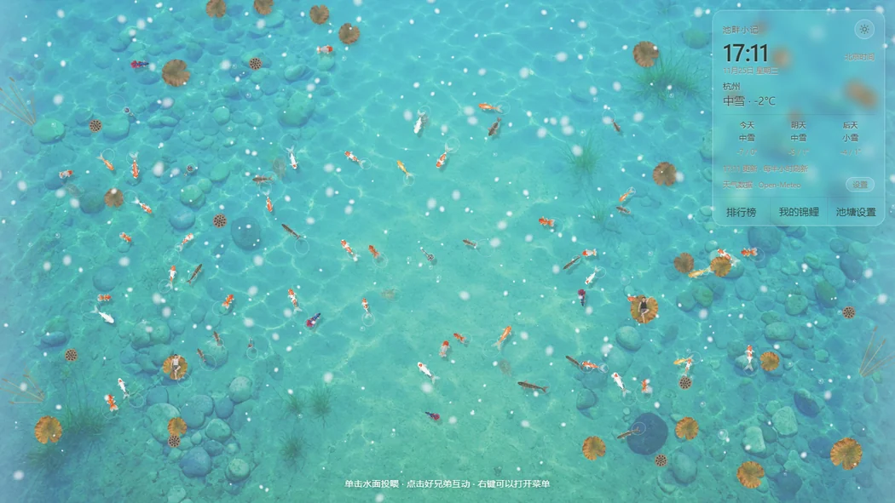
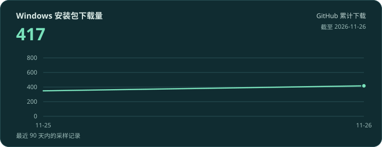

# 塘里

一方会随天气、时辰和四季变化的 Windows 桌面池塘。可以看鱼巡游、投喂，也可以铺到桌面图标下方，作为动态壁纸。

[下载 Windows 安装版](https://github.com/devin2255/tangli/releases/download/v1.1.11/Tangli-v1.1.11-Setup.exe) · [下载便携版](https://github.com/devin2255/tangli/releases/download/v1.1.11/Tangli-v1.1.11-Windows-x64.exe) · [v1.1.11 更新说明](https://github.com/devin2255/tangli/releases/tag/v1.1.11)



## 实际运行效果

| 冬日落雪 | 音乐表演 |
| --- | --- |
|  |  |

## 安装与使用

- 首次使用推荐下载 `Setup.exe`。安装后可从 Windows 开始菜单打开「塘里」。便携版直接运行即可。
- 单击水面投喂，点击荷叶上的人物触发互动。右键可以打开菜单，或从「池塘设置」调整鱼群数量、人物和画面性能。
- 按 `F11` 铺到桌面图标下方，再按一次恢复窗口。也可以从系统托盘切换桌面模式或检查更新。
- 右上角可以选择城市、查看当地天气，也可以预览季节、天气、时段和音乐表演。v1.1.11 的城市搜索支持中文、拼音和首字母，覆盖省市区县及港澳台。

### 池塘里有什么

- **四季与昼夜**。春有蝌蚪，夏有荷花与蜻蜓，秋有枯荷，冬天落雪时会逐渐积雪。月亮随时段和月相升落。
- **鱼群与自绘锦鲤**。不同鱼有各自的游速和摆尾，可以把自己画的锦鲤放进池塘，也可以查看本次运行的吃粮排行榜。
- **荷叶人物与音乐表演**。两位好兄弟会在荷叶休息，落水后会游回空荷叶。Windows 检测到受支持的播放器在播放时，人物和鱼群会随音乐表演。节拍分析在本机进行，音频不保存、不上传。

如果无法直连 GitHub，可尝试通过 [镜像一](https://gh-proxy.com/https://github.com/devin2255/tangli/releases/download/v1.1.11/Tangli-v1.1.11-Setup.exe) 或 [镜像二](https://ghproxy.net/https://github.com/devin2255/tangli/releases/download/v1.1.11/Tangli-v1.1.11-Setup.exe) 下载同一安装包。镜像由第三方提供，应用内更新会校验签名和文件哈希。

## 安装包下载趋势

[](https://github.com/devin2255/tangli/releases)

仅统计 GitHub Releases 中正式版 Windows 安装包（`Setup.exe`）的下载次数。GitHub Actions 每小时采样，按北京时间记录每日累计值。[查看采样记录](docs/downloads/history.json)

## 本地开发

在 Windows 上安装 Node.js 后运行：

```bash
npm ci
npm start
npm test
```

运行 `npm run dist` 生成 Windows 便携版 `dist/塘里.exe`。发行及签名维护见 [国内更新发布](docs/国内更新发布.md)。
